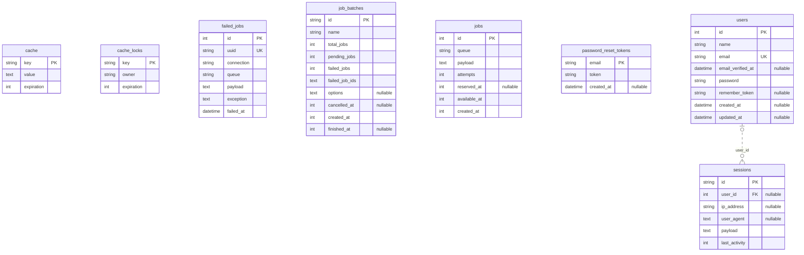
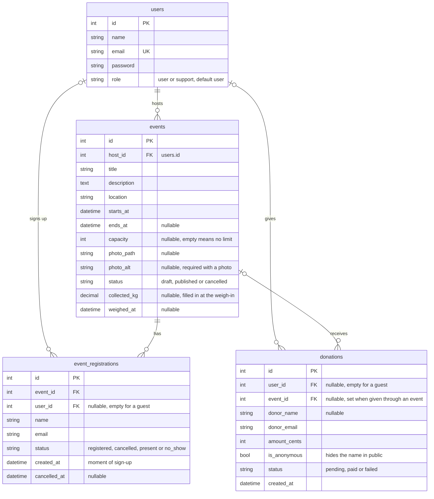

# Datamodel

Dit document heeft twee diagrammen, allebei in Mermaid, die GitHub direct
tekent:

1. **Huidige database**: de tables die de migrations nu aanmaken. Dit diagram
   wordt gegenereerd, dus pas je het nooit met de hand aan.
2. **Gepland model**: events, registrations en donations. Dit diagram is met de
   hand geschreven en is de basis voor de volgende migrations.

## Zo lees je de diagrammen

- `PK` is de primary key, `FK` een foreign key en `UK` een unique index op één
  column. Een column met `nullable` mag leeg (null) zijn.
- Een doorgetrokken lijn is een foreign key die de database afdwingt. Een
  stippellijn is een relatie die alleen uit Laravel's naamgeving volgt (een
  `user_id` naast een `users`-table), zonder constraint erachter.
- `||` betekent precies één, `|o` nul of één, `o{` nul of meer. Dus
  `users |o--o{ donations` zegt: een donation hoort bij hooguit één user (of bij
  niemand), en een user kan nul of meer donations hebben.
- De types zijn vereenvoudigd tot `int`, `string`, `text`, `datetime`, `bool`
  en dergelijke. Ze tonen de soort data, niet het exacte MySQL-type.

## Huidige database

Op dit moment bevat de database de authenticatie en users, plus de tables die
Laravel zelf gebruikt: `sessions` voor ingelogde sessies,
`password_reset_tokens` voor wachtwoordherstel, en `cache`, `jobs` en
`failed_jobs` voor de cache en de queue.

Het blok tussen de markers `erd:start` en `erd:end` wordt gegenereerd uit de
migrations. Draai `make erd` (of `php artisan erd:generate`) nadat je een
migration hebt aangepast, en commit het resultaat. `make test` faalt zolang het
diagram en de migrations niet overeenkomen. Alles buiten de markers mag je zelf
schrijven.

<!-- erd:start -->

<!-- erd:end -->

## Gepland model: events, registrations en donations

Nog niet gebouwd. Dit is het basismodel voor de volgende migrations, met alleen
de columns die de schermen in Figma nodig hebben. `users` bestaat al; alleen de
column `role` komt erbij.

### De tables

**`users`**: iedereen met een account. Er zijn twee rollen in `role`:

- `user`: de standaard. Een user kan zich aanmelden voor events, doneren en
  zelf events aanmaken.
- `support`: een supportmedewerker van het platform. Die kan alle events,
  registrations en donations inzien, om vragen van deelnemers en donateurs te
  beantwoorden.

Host is geen rol. Wie een event aanmaakt, is de host van dat event
(`events.host_id`). In de interface heet de host "Organizer".

**`events`**: een cleanup-actie.

- `status` bepaalt wat zichtbaar is. Een `draft` ziet alleen de host, een
  `published` event staat op de site, en een `cancelled` event blijft zichtbaar
  met die melding.
- `capacity` bepaalt of het event "Registration open" of "Full" toont. Het
  aantal deelnemers telt de registrations met status `registered` of
  `present`.
- Na afloop vult de host bij de weigh-in in hoeveel kilo afval er is opgehaald
  (`collected_kg`, `weighed_at`). Daaruit komen de impact-cijfers.

**`event_registrations`**: één aanmelding voor één event.

- Aanmelden kan **met of zonder account**. Bij een user staat `user_id`
  ingevuld; een guest heeft geen `user_id`. `name` en `email` worden altijd
  opgeslagen, zodat de host iedereen op dezelfde manier ziet en kan mailen.
- Een unique index op `event_id` + `email` voorkomt dat iemand zich twee keer
  aanmeldt.
- `status` begint als `registered`. Annuleren zet hem op `cancelled` en vult
  `cancelled_at`. Op de dag zelf zet de host hem op `present` of `no_show`.
- Een guest annuleert via een signed link in de bevestigingsmail, daar is geen
  extra column voor nodig.
- De timeline telt aanmeldingen op `created_at` en annuleringen op
  `cancelled_at`.

**`donations`**: geld dat via de donate-pagina binnenkomt.

- Doneren kan ook **zonder account**: dan is `user_id` leeg en staan naam en
  e-mail in `donor_name` en `donor_email`. Het e-mailadres is nodig voor de
  bevestiging.
- `event_id` is ingevuld als iemand via een event doneert. Zo kan de host zien
  wat het event heeft opgebracht, en telt de timeline donaties per dag.
- Bedragen staan in centen (`amount_cents`), dus € 25,00 is `2500`. Zo zijn er
  geen afrondingsfouten.
- Alleen donations met status `paid` tellen mee in totalen en milestones.
  Milestones zoals "First gift" worden berekend uit iemands betaalde donations
  en hebben dus geen eigen table nodig.

### Wie ziet wat

| Wie                        | Registrations                              | Donations                                                                 |
| -------------------------- | ------------------------------------------ | ------------------------------------------------------------------------- |
| Bezoeker of guest          | Alleen het aantal deelnemers, nooit namen  | Totalen, en namen alleen als `is_anonymous` uit staat                     |
| User                       | Eigen registrations                        | Eigen donations, ook de anonieme                                          |
| Host (van dat event)       | Naam, e-mail en status van alle deelnemers | Totaal, bedragen en namen bij het eigen event; anoniem blijft "Anonymous" |
| Support (`role = support`) | Alles, van elk event                       | Alles, ook naam en e-mail achter een anonieme donation                    |

Anoniem doneren verbergt dus alleen de naam naar buiten en naar de host. De
gegevens blijven bewaard, omdat support ze nodig heeft voor vragen en
terugbetalingen. Dit leg je vast in Laravel policies (in `app/Policies/`), niet
in de views.

### Als een user het account verwijdert

Het profiel heeft al een knop om je account te verwijderen. Daarom:

- `event_registrations.user_id` en `donations.user_id` worden `null`
  (`nullOnDelete`). De aanmelding en de donation blijven bestaan met de naam en
  het e-mailadres van dat moment, net als bij een guest. Zo kloppen de totalen
  en de administratie.
- Een user die host is van een event dat nog moet komen, kan het account pas
  verwijderen als dat event is geannuleerd of overgedragen (`restrictOnDelete`
  op `events.host_id`).

### Bewust nog niet opgenomen

Projects (de project cards met een fundraising goal), tags en categorieën, en
de details van een payment provider. Die voeg je toe zodra dat werk begint.
